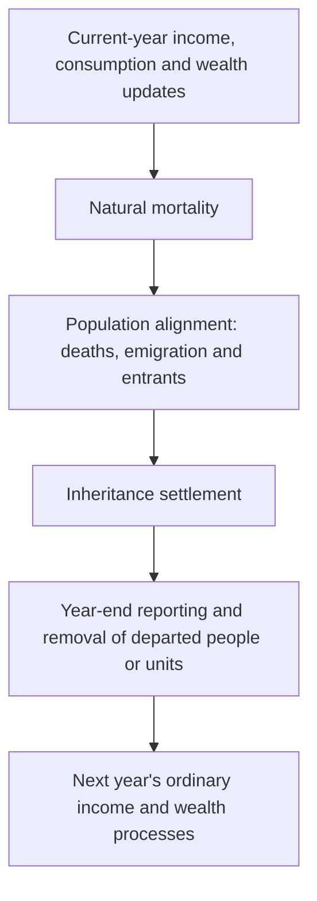

# Bequests in SimPaths: a review of the current code changes

## 1. Scope, version and how to use this document

**Reviewed on:** 7 October 2026. **Working directory:** `D:\GitHub\SimPaths`. **Branch:** `wealth-module`. **Git HEAD:** `9d42d0ee537ba051713876bc52b068e25e83774e`, the merge of Justin's updates. This review describes the **current working files**, including additions and edits that are not yet committed. It covers the accumulated bequest work, not only the most recent alignment-death correction.

The account below was checked against the current source and the differences from HEAD. New files such as `InheritanceModule.java` are currently untracked, so ordinary `git diff` does not display their contents. Unrelated changes elsewhere in the working tree are not automatically attributed to inheritance.

Each numbered section explains **what changed, why it changed, what the code actually does, and where to inspect it**. Links open the current local file at its starting line. Line numbers are a snapshot and can move after later edits. Sections 20–22 distinguish completed checks from questions that still merit review. This document does not change model behaviour or certify a complete accounting reconciliation.

For a shorter statement of the assumptions, see [the baseline design](wealth-inheritance-baseline-design.md). The [first-death alternative](wealth-inheritance-first-death-alternative.md) is historical and is not selectable in the current code.

### 1.1 Recovery performed during this review

`SimPathsModel.java` was accidentally deleted during preparation. With your authorization, it was recovered from the saved Git blob `760d84234b4902debc9fef1ead2622dbe7a078c5`, with the alignment-entry audit call restored from the code read earlier in this review. A separate compilation produced all seven `SimPathsModel` class files **byte-identical** to the pre-deletion build. The accidental staged deletion was removed, and all source links below were regenerated against the restored file. This recovered the edited model rather than replacing it with the older HEAD version.

## 2. The rule implemented today

| Event | Non-pension wealth | Remaining pension pot |
| --- | --- | --- |
| A responsible adult dies and a partner survives | Pooled financial and housing wealth remains in the unit; retain the deceased's child branches for the final estate | With the pension switch on, pay the eligible unaccessed pot to the partner |
| The last responsible adult dies | Distribute positive net financial wealth plus net housing equity to child branches; use synthetic recipients if needed | With the switch on, distribute the deceased's eligible pot separately |
| Both partners die in the same year | Settle the pooled estate once; neither counts as a living partner | Settle each eligible individual pot separately |
| A person emigrates through alignment | No bequest; record wealth leaving the sample according to the unit's surviving-adult position | No bequest; record departing stock |

Both `Death` and `DeathAlignment` are deaths for these rules. `EmigrationAlignment` is not. There is one implemented non-pension method; no `enableInheritance` or `bequestMode` selector remains. The separate `transferDcPensionAtDeath` option controls pension transfers only.

**Code:** classification [InheritanceModule.java:579](D:/GitHub/SimPaths/src/main/java/simpaths/model/InheritanceModule.java:579) and [InheritanceModule.java:584](D:/GitHub/SimPaths/src/main/java/simpaths/model/InheritanceModule.java:584); annual settlement [InheritanceModule.java:146](D:/GitHub/SimPaths/src/main/java/simpaths/model/InheritanceModule.java:146); pension settlement [InheritanceModule.java:273](D:/GitHub/SimPaths/src/main/java/simpaths/model/InheritanceModule.java:273).

The current death predicate is:

```java
private boolean isDeath(Person person) {
    return SampleExit.Death.equals(person.getSampleExit()) ||
            SampleExit.DeathAlignment.equals(person.getSampleExit());
}
```

Emigration has its own predicate and does not enter this one. The latest correction also changed the final-estate and exiting-partner checks, as explained in Section 19.

The current trigger is the last **responsible adult**, not the last member of the unit. Children can remain. The responsibility threshold is 18: [Parameters.java:294](D:/GitHub/SimPaths/src/main/java/simpaths/data/Parameters.java:294). Age in beneficiary matching is the person's own age; it is not the unit reference person's age used in many presentation charts.

## 3. A new inheritance module and its stored information

**Change:** Added `InheritanceModule.java` as the central settlement routine. It separates inheritance transactions from the regressions that normally predict wealth, income and consumption.

**Why:** A death can affect several people and units. One routine must identify heirs, remove estate stock, credit recipients, preserve lineage and write a consistent record.

**Code:** class [InheritanceModule.java:20](D:/GitHub/SimPaths/src/main/java/simpaths/model/InheritanceModule.java:20); state [InheritanceModule.java:23](D:/GitHub/SimPaths/src/main/java/simpaths/model/InheritanceModule.java:23).

| Stored information | Purpose |
| --- | --- |
| `knownPeople` | Retain references to people, including those who have left, so family branches can be traced later |
| `childrenByParent` | Find simulated children from preserved parent IDs |
| `sourceChildren` | Remember child links recorded before independent household sampling |
| `carriedBranches` | Preserve the first deceased partner's child branches until the survivor's final estate |
| `minorTrusts` | Hold a minor's inheritance outside spendable financial wealth |
| `settledDeaths` | Prevent repeated settlement of the same person; despite the name, it also stores processed emigrant exits |
| Transfer, match, balance, alignment-flow and death-event lists | Keep records for export |

`currentPopulationIds` plus `SampleExit.NotYet` determine whether someone can receive money: [InheritanceModule.java:574](D:/GitHub/SimPaths/src/main/java/simpaths/model/InheritanceModule.java:574). A person merely remaining in `knownPeople` is not enough. These maps are held in memory; they are not a persisted family database or a restart mechanism.

## 4. Connecting inheritance to the model and the annual schedule

**Change:** Added a module instance, settings, family-link bookkeeping and an output path to `SimPathsModel`: [SimPathsModel.java:173](D:/GitHub/SimPaths/src/main/java/simpaths/model/SimPathsModel.java:173). Initialisation passes the run seed, synthetic-recipient count and pension switch to the module: [SimPathsModel.java:393](D:/GitHub/SimPaths/src/main/java/simpaths/model/SimPathsModel.java:393). Setters support configuration loading: [SimPathsModel.java:3386](D:/GitHub/SimPaths/src/main/java/simpaths/model/SimPathsModel.java:3386).

**Change:** Added `SettleInheritance` to the model processes, scheduled it after mortality and population alignment, and dispatch it to `settleYear`: [SimPathsModel.java:672](D:/GitHub/SimPaths/src/main/java/simpaths/model/SimPathsModel.java:672) and [SimPathsModel.java:927](D:/GitHub/SimPaths/src/main/java/simpaths/model/SimPathsModel.java:927).



**Why:** Both natural and alignment death flags must be available before heirs are selected. Settlement must finish before departing units disappear.

**Economic timing:** Cash receipts enter closing-year wealth. They do not rerun that year's consumption or investment-income calculation. They can affect subsequent years through the ordinary wealth and income processes. In the initial year, the scheduled mortality/alignment/settlement still runs; do not assume every later-year event also runs in that first year.

**Output integration:** [SimPathsModel.java:428](D:/GitHub/SimPaths/src/main/java/simpaths/model/SimPathsModel.java:428) locates the run's CSV directory from its database path. [SimPathsModel.java:1016](D:/GitHub/SimPaths/src/main/java/simpaths/model/SimPathsModel.java:1016) writes the ledgers at cleanup; failures raise an exception. [SimPathsModel.java:789](D:/GitHub/SimPaths/src/main/java/simpaths/model/SimPathsModel.java:789) records the chosen bequest settings in run metadata. The final ledgers are not a continuously saved transaction log during an unfinished run.

## 5. Recording families before population sampling

**Change:** Index the input households' parent–child relationships before sampling: [SimPathsModel.java:2805](D:/GitHub/SimPaths/src/main/java/simpaths/model/SimPathsModel.java:2805) calls [InheritanceModule.java:81](D:/GitHub/SimPaths/src/main/java/simpaths/model/InheritanceModule.java:81). Added the transient `Person.inheritanceSourceId` and copy-constructor assignment: [Person.java:60](D:/GitHub/SimPaths/src/main/java/simpaths/model/Person.java:60) and [Person.java:342](D:/GitHub/SimPaths/src/main/java/simpaths/model/Person.java:342).

**Why:** A child's source household may be absent from the simulated sample, or sampled more than once. Without a source index, the parent could appear childless simply because no unique child copy is available.

`sourceChildren` records only links present in the input; it does not discover children absent from the survey records, and it does not use `nchildlv`. The source ID connects a clone to its recorded ancestry; it is not proof that any other clone with the same source origin is its unique relative.

## 6. Repairing parent links when households and units are cloned

**Change:** Household cloning now shares a source-to-clone map across its benefit units, waits until those units have been copied, then remaps parents: [SimPathsModel.java:1521](D:/GitHub/SimPaths/src/main/java/simpaths/model/SimPathsModel.java:1521). The unit-level wrapper and implementation are at [SimPathsModel.java:1542](D:/GitHub/SimPaths/src/main/java/simpaths/model/SimPathsModel.java:1542) and [SimPathsModel.java:1555](D:/GitHub/SimPaths/src/main/java/simpaths/model/SimPathsModel.java:1555). `PendingParentLink` holds the source IDs until remapping can run.

**Change:** [SimPathsModel.java:1593](D:/GitHub/SimPaths/src/main/java/simpaths/model/SimPathsModel.java:1593) resolves a parent within the same cloned household or unit. Missing parents are set to null rather than left pointing to an unrelated source person. Initial-population links that cannot be resolved locally are retained for the later cross-household check.

**Change:** [SimPathsModel.java:1616](D:/GitHub/SimPaths/src/main/java/simpaths/model/SimPathsModel.java:1616) attempts unresolved links after the initial sample has been constructed. [SimPathsModel.java:1647](D:/GitHub/SimPaths/src/main/java/simpaths/model/SimPathsModel.java:1647) accepts a cross-household link only if both the source child and source parent have exactly one sampled copy. The result is called during initialisation at [SimPathsModel.java:2924](D:/GitHub/SimPaths/src/main/java/simpaths/model/SimPathsModel.java:2924).

**Why:** Parent IDs must identify the correct simulated people. Picking one among multiple copies would invent a family connection.

**Remaining limit:** Ambiguous links remain unresolved and enter the source-branch fallback. The family-link audit counts references, not unique families or estate values. Birth already recorded the mother's ID and the current partner's ID as father at [Person.java:286](D:/GitHub/SimPaths/src/main/java/simpaths/model/Person.java:286); that birth assignment was existing code, not a new biological-parent inference.

## 7. Preserving ancestry and separating it from custody

**Change:** Removed two updates that replaced a child's parent IDs with the adults currently in their benefit unit. The retained-ancestry comments are at [Person.java:698](D:/GitHub/SimPaths/src/main/java/simpaths/model/Person.java:698) and [Person.java:2396](D:/GitHub/SimPaths/src/main/java/simpaths/model/Person.java:2396). Added the controlled parent-ID setter [Person.java:8113](D:/GitHub/SimPaths/src/main/java/simpaths/model/Person.java:8113).

**Why:** A move, separation or new partner should not erase the original recorded parent for inheritance. Recorded parent IDs are an ancestry convention and can include the father's existing birth assignment; they are not a new verified biological-family register.

**Related behavioural change:** [Person.java:2521](D:/GitHub/SimPaths/src/main/java/simpaths/model/Person.java:2521) now assigns dependent children to the current female responsible adult, or the male adult if there is no female adult, when a new unit forms. Previously the selection relied on mother/father ID equality.

This is a change to **who follows whom during household reorganisation**, not merely an audit field. It was added so preserving ancestry would not break child moves, but it deserves separate review for stepfamilies and other custody situations. The current inheritance tests do not validate every custody transition.

## 8. Rebuilding initial populations instead of using the processed cache

**Change:** Initialisation sets `Processed processed = null` at [SimPathsModel.java:2760](D:/GitHub/SimPaths/src/main/java/simpaths/model/SimPathsModel.java:2760), bypassing processed-population loading. The corresponding save call was removed from this initialisation path.

**Why:** The earlier processed cache did not preserve the unresolved source-family information required by this inheritance design. Rebuilding from the raw starting database allows indexing before sampling.

**Implication:** This can increase startup time and change the initialisation path compared with older runs using the processed cache. The `PersistPopulation` setting no longer restores that old cache path here. The nearby phrase “while inheritance is enabled” is a historical comment: inheritance is now always active, so the bypass is unconditional in this method. There is no general restart support for inheritance maps and trusts.

## 9. Constructing an estate without adding wealth twice

**Change:** [InheritanceModule.java:146](D:/GitHub/SimPaths/src/main/java/simpaths/model/InheritanceModule.java:146) registers newly seen people and identifies unprocessed death/emigration exits. [InheritanceModule.java:160](D:/GitHub/SimPaths/src/main/java/simpaths/model/InheritanceModule.java:160) sorts them by person ID. [InheritanceModule.java:243](D:/GitHub/SimPaths/src/main/java/simpaths/model/InheritanceModule.java:243) records each affected unit's net financial balance, net housing equity and number of responsible adults before transfers.

The final non-pension estate is formed at [InheritanceModule.java:216](D:/GitHub/SimPaths/src/main/java/simpaths/model/InheritanceModule.java:216):

```text
raw estate = net financial balance + net housing equity
distributable estate = max(0, raw estate)
```

Net financial balance is already after unsecured debt. Net housing equity is already after mortgage debt. Those debts are not subtracted again. A negative estate produces an `insolvent_unit` write-off record; heirs do not inherit a negative balance in this model.

After distribution, [BenefitUnit.java:591](D:/GitHub/SimPaths/src/main/java/simpaths/model/BenefitUnit.java:591) clears the departing unit's net financial balance, housing value/mortgage and aggregate pension stock. This is essential: crediting recipients without removing the estate would create wealth.

**Housing sale convention:** The active path combines net housing equity with net financial wealth and pays cash, then clears the home. It does not transfer a dwelling, re-estimate the child's house value or record an explicit sale transaction. `sellHomeForInheritance` at [BenefitUnit.java:578](D:/GitHub/SimPaths/src/main/java/simpaths/model/BenefitUnit.java:578) is a retained helper with no current call site; it is not the operative sale path.

**Correction:** The pooled estate reference must be a deceased responsible adult (`unit.getMale()` or `unit.getFemale()`). Dependents are excluded. If both adults die in the annual period, the higher-ID adult supplies the matching age, region, education, random seed and ledger attribution. This is a deterministic tie convention, not chronological death order. Section 21.6 records the correction and its regression tests.

## 10. A surviving partner retains the pooled non-pension wealth

**Change:** At [InheritanceModule.java:184](D:/GitHub/SimPaths/src/main/java/simpaths/model/InheritanceModule.java:184), a surviving partner's personal non-pension balance is increased by the exited person's equal share of the snapshotted unit wealth. The pooled unit balance itself is already retained; no extra cash is added for that non-pension share.

**Why:** The unit owns the pooled balance, but personal balances are subsequently used when people form new units. Updating only the unit would leave the survivor's personal position inconsistent.

For a couple with £100,000 of net non-pension wealth and equal £50,000 personal shares:

- After the first death, the unit still has £100,000.
- Add £50,000 to the survivor's personal balance, so it also reflects £100,000.
- Record `retained_in_unit`, not an additional £50,000 cash transfer.

For death, merge the deceased's child branches into the survivor's carried branches at [InheritanceModule.java:342](D:/GitHub/SimPaths/src/main/java/simpaths/model/InheritanceModule.java:342). These are eligibility for what remains at the final death; they are not protected ownership claims. The survivor can consume or invest the wealth.

The personal adjustment can be negative for a negative pooled balance. The displayed retained-wealth ledger value is floored at zero, so that ledger row alone cannot reconstruct a signed personal-balance adjustment.

## 11. Finding children, unresolved branches and descendants

**Change:** [InheritanceModule.java:320](D:/GitHub/SimPaths/src/main/java/simpaths/model/InheritanceModule.java:320) constructs branches for linked children and for source-record children not represented by a linked simulated person. [InheritanceModule.java:296](D:/GitHub/SimPaths/src/main/java/simpaths/model/InheritanceModule.java:296) combines these with branches carried from earlier deceased partners and removes a corresponding unresolved source branch when a linked version is already represented.

**Change:** [InheritanceModule.java:381](D:/GitHub/SimPaths/src/main/java/simpaths/model/InheritanceModule.java:381) follows each branch:

1. A living child receives its branch.
2. A deceased child can be represented by its own descendants, recursively.
3. A known unresolved or out-of-sample child branch receives a synthetic stand-in.
4. A deceased child with no descendant branch is omitted from the eligible branches.

The visited-ID set prevents recursion cycles. Both natural and alignment-deceased children follow the descendant path. Carried stepchild branches from an unrelated later partner are not substituted for that deceased child's own descendants.

**Distribution:** [InheritanceModule.java:348](D:/GitHub/SimPaths/src/main/java/simpaths/model/InheritanceModule.java:348) divides the estate equally between eligible branches, then divides a represented branch between its eligible descendant branches. This is equal **branch** sharing, not necessarily the same amount for every child and grandchild. A known unlinked branch retains its share rather than enlarging identified children's shares. These routines use only recorded links; they do not infer an unrecorded number of children.

## 12. Synthetic beneficiaries when recorded heirs are unavailable

**Change:** [InheritanceModule.java:411](D:/GitHub/SimPaths/src/main/java/simpaths/model/InheritanceModule.java:411) allocates a childless estate to the configured number of synthetic recipients (two in both ageing configurations). A known unresolved branch requests one stand-in for that branch. An unmatched intended share remains explicitly `unmatched`; the other recipient does not automatically get it.

**Matching code:** candidate construction [InheritanceModule.java:444](D:/GitHub/SimPaths/src/main/java/simpaths/model/InheritanceModule.java:444), conditions [InheritanceModule.java:479](D:/GitHub/SimPaths/src/main/java/simpaths/model/InheritanceModule.java:479), adjacent education [InheritanceModule.java:495](D:/GitHub/SimPaths/src/main/java/simpaths/model/InheritanceModule.java:495).

| Tier recorded | Criteria actually used |
| --- | --- |
| `same_education` | Exact target age; same region; identical education category |
| `adjacent_education` | Exact target age; same region; adjacent completed Low/Medium/High category |
| `any_education` | Exact target age and same region; education unrestricted |
| `age_relaxed` | Same region; choose the available age closest to the target; education unrestricted |
| `national` | Any remaining living candidate nationally; age and education unrestricted |

For each intended recipient, the target age is donor age minus an integer draw from 20 through 30 inclusive. `InEducation` is not an adjacent completed-education level; exact equality can still match it in tier zero. The national fallback can select someone outside the intended age gap. The exported `age_gap` is the **drawn target gap**, not necessarily the realised donor-minus-recipient age after fallback; join `Person.csv` to calculate the realised gap.

Used recipient IDs cannot be reused within that allocation. Identified recipients are reserved before synthetic selection. If candidates outside the donor's unit exist in the selected tier, they are preferred. The code does **not** explicitly ensure the two recipients are in different units from each other; two different people can belong to the same receiving unit. Same-donor-unit candidates are not absolutely prohibited if no outside candidate remains at that tier. These details should be reviewed rather than silently equated with the general design wording.

## 13. Random selection and using the same recipients for different assets

**Change:** [InheritanceModule.java:411](D:/GitHub/SimPaths/src/main/java/simpaths/model/InheritanceModule.java:411) creates a local `SplittableRandom` from the module seed, donor ID, year and matching-purpose hash. Candidates are sorted by person ID before drawing at [InheritanceModule.java:444](D:/GitHub/SimPaths/src/main/java/simpaths/model/InheritanceModule.java:444).

**Why:** Inheritance matching should not consume the simulation engine's unrelated random draws. It should be reproducible for fixed population IDs, family branches and candidate order.

For a childless donor, the `unaccessed_pension` matching purpose is mapped to `nonpension_estate`. A pension pot and a final non-pension estate paid at that death therefore use the same synthetic recipients, with separate ledger reasons. Housing and financial wealth already form one pooled estate; they do not each draw another pair of heirs.

This is not a promise of identical matches across demographic scenarios: populations, person IDs and eligible candidates may differ. With several unresolved branches, branch processing and previously reserved recipients also matter.

## 14. Crediting adults and keeping personal and unit balances consistent

**Change:** [InheritanceModule.java:501](D:/GitHub/SimPaths/src/main/java/simpaths/model/InheritanceModule.java:501) credits an adult recipient through both [BenefitUnit.java:557](D:/GitHub/SimPaths/src/main/java/simpaths/model/BenefitUnit.java:557) and [Person.java:8353](D:/GitHub/SimPaths/src/main/java/simpaths/model/Person.java:8353). It records an immediate cash transfer after updating balances.

The unit method increases its **net financial balance** and recalculates total wealth. It uses the existing financial setter [WealthNonPension.java:203](D:/GitHub/SimPaths/src/main/java/simpaths/model/benefitunit/WealthNonPension.java:203), which also recomputes non-pension wealth. The underlying net-to-gross conversion is [WealthFinancial.java:222](D:/GitHub/SimPaths/src/main/java/simpaths/model/benefitunit/WealthFinancial.java:222); existing unsecured debt is not automatically repaid by this inheritance transaction.

**Why:** The recipient unit must have the money now, and the recipient's personal balance must carry it into a later move, union or separation. These are two representations of the same receipt, not two separate assets.

The existing personal annual accumulation method [Person.java:1002](D:/GitHub/SimPaths/src/main/java/simpaths/model/Person.java:1002) carries the prior personal balance into the next year. Existing ordinary budget accumulation is at [BenefitUnit.java:517](D:/GitHub/SimPaths/src/main/java/simpaths/model/BenefitUnit.java:517) and [WealthNonPension.java:65](D:/GitHub/SimPaths/src/main/java/simpaths/model/benefitunit/WealthNonPension.java:65). These budget methods were not replaced with a separate inheritance saving equation. Bequests are a one-off capital windfall, not added again as annual disposable income or an additional financial-return rate.

The adult-credit branch makes both representations explicit:

```java
recipient.getBenefitUnit().addInheritanceCash(value);
recipient.addInheritanceToPersonalFinancialBalance(value);
record(year, deceased, recipient, "cash", "immediate", value, reason);
```

## 15. Minors' trusts, spendable wealth and exits

**Change:** [InheritanceModule.java:501](D:/GitHub/SimPaths/src/main/java/simpaths/model/InheritanceModule.java:501) places a recipient under 18's allocation in `minorTrusts`, rather than spendable financial cash. [InheritanceModule.java:517](D:/GitHub/SimPaths/src/main/java/simpaths/model/InheritanceModule.java:517) releases it at the responsibility threshold if the holder is still living, credits personal and unit balances, and removes the trust entry.

**Change:** [BenefitUnit.java:548](D:/GitHub/SimPaths/src/main/java/simpaths/model/BenefitUnit.java:548) includes living members' trust assets in reported total wealth. [BenefitUnit.java:4662](D:/GitHub/SimPaths/src/main/java/simpaths/model/BenefitUnit.java:4662) excludes those assets from the decision wealth measure. Call sites were changed in tax evaluation [BenefitUnit.java:852](D:/GitHub/SimPaths/src/main/java/simpaths/model/BenefitUnit.java:852), decision states [States.java:67](D:/GitHub/SimPaths/src/main/java/simpaths/model/decisions/States.java:67), and the person's decision wealth calculation [Person.java:2372](D:/GitHub/SimPaths/src/main/java/simpaths/model/Person.java:2372).

**Why:** A minor's inheritance belongs in reported wealth without being immediately available for the household's consumption decisions. In the current pooled implementation there are no deferred housing claims; the zero claim fields retained in the export are historical schema fields.

This exclusion does not make every other item in the model's decision wealth measure liquid. The existing treatment of housing and pension wealth in decisions remains a separate model convention.

**Existing implementation limits:** There is no annual trust-return calculation here. [InheritanceModule.java:531](D:/GitHub/SimPaths/src/main/java/simpaths/model/InheritanceModule.java:531) removes a trust when its holder leaves or dies and records it as out of sample. [InheritanceModule.java:545](D:/GitHub/SimPaths/src/main/java/simpaths/model/InheritanceModule.java:545) similarly removes trusts from living minors in affected units with no surviving responsible adult. These are explicit boundary treatments, not transfers to a guardian or a fresh estate. They deserve review if the intended rule is that all positive inherited assets must always remain within simulated households.

## 16. Starting pension wealth: modelled pot, not a maintained DB/DC split

**Change:** Added component fields to person/unit objects, their copy constructors and getters: [BenefitUnit.java:81](D:/GitHub/SimPaths/src/main/java/simpaths/model/BenefitUnit.java:81), [BenefitUnit.java:311](D:/GitHub/SimPaths/src/main/java/simpaths/model/BenefitUnit.java:311), [Person.java:462](D:/GitHub/SimPaths/src/main/java/simpaths/model/Person.java:462). Added component storage and accessors to `PrivatePension`: [PrivatePension.java:19](D:/GitHub/SimPaths/src/main/java/simpaths/model/person/PrivatePension.java:19), [PrivatePension.java:49](D:/GitHub/SimPaths/src/main/java/simpaths/model/person/PrivatePension.java:49), [PrivatePension.java:297](D:/GitHub/SimPaths/src/main/java/simpaths/model/person/PrivatePension.java:297) and [PrivatePension.java:308](D:/GitHub/SimPaths/src/main/java/simpaths/model/person/PrivatePension.java:308).

**Current initialization:** [BenefitUnit.java:4709](D:/GitHub/SimPaths/src/main/java/simpaths/model/BenefitUnit.java:4709) validates a supplied complete component split against the reported total, rejects a partial split, then uses **the whole total as one modelled pot**. With the legacy input containing only `wealthPensValue`, it also uses the whole total and marks the unsplit-input flag. Source DB, in-payment and other fields become zero in this current convention.

**Individual allocation:** [Person.java:724](D:/GitHub/SimPaths/src/main/java/simpaths/model/Person.java:724) gives each responsible adult in a couple half of the unit's starting pension total; a single adult receives the full total. This equal partner split existed before the inheritance changes. The extension initializes the pension component object consistently with that split. It does not recover the source individual's actual ownership.

**Why this differs from an earlier implementation:** We initially explored maintaining source DC funds separately from DB and capitalised in-payment rights. Following the agreed simplification with Justin, the active model returned to treating the imputed starting total as a pre-retirement modelled pot. Component field names therefore should not be interpreted as evidence that the simulation maintains the original source pension types.

A person already retired at the start has a retired flag and cannot bequeath that starting pot under the retirement eligibility check. Their starting stock is cleared by the subsequent retired-pension update path; the initial-year snapshot can still show the imputed value before that update. For non-retired people the combined source total can overstate an actually transferable pension fund. This is a documented modelling approximation.

## 17. Pension accumulation, retirement and bequest eligibility

**Change:** [PrivatePension.java:167](D:/GitHub/SimPaths/src/main/java/simpaths/model/person/PrivatePension.java:167) now receives the previous `PrivatePension` object, grows its total into the current modelled pot, resets the other components, and adds employee/employer occupational and personal contributions when employed. [Person.java:1056](D:/GitHub/SimPaths/src/main/java/simpaths/model/Person.java:1056) calls it and updates exported person fields; [BenefitUnit.java:494](D:/GitHub/SimPaths/src/main/java/simpaths/model/BenefitUnit.java:494) sums responsible adults' pension fields.

**Change:** [PrivatePension.java:201](D:/GitHub/SimPaths/src/main/java/simpaths/model/person/PrivatePension.java:201) receives the previous pension object, computes the lump sum and annuity, marks retirement and sets all remaining stock components to zero. [Person.java:2204](D:/GitHub/SimPaths/src/main/java/simpaths/model/Person.java:2204) calls it. For established retirees, [Person.java:2181](D:/GitHub/SimPaths/src/main/java/simpaths/model/Person.java:2181) creates the current pension object for income projection; [PrivatePension.java:192](D:/GitHub/SimPaths/src/main/java/simpaths/model/person/PrivatePension.java:192) maintains income without restoring a pot.

**Transfer rule:** [InheritanceModule.java:273](D:/GitHub/SimPaths/src/main/java/simpaths/model/InheritanceModule.java:273) transfers a positive remaining modelled pot only when the switch is on, `PrivatePension.isRetired()` is false, and labour status is not `Retired`. A living partner gets the whole pot; otherwise own child branches are used, then the synthetic fallback.

The routine removes the deceased's aggregate unit pension stock via [BenefitUnit.java:570](D:/GitHub/SimPaths/src/main/java/simpaths/model/BenefitUnit.java:570) before a pension payment. It does not put the pot into the pooled non-pension estate a second time. With the switch off, the stock is removed without a pension bequest, while non-pension inheritance continues.

Eligibility is operationally tied to **modelled retirement**, not a separate observation of whether any pension income has ever been received. Because income/retirement updates precede mortality, a person who retires and dies in the same simulation year can have a zero pot at settlement. The annual model does not observe within-year dates. The copied `getPrivatePension()` value at [Person.java:8328](D:/GitHub/SimPaths/src/main/java/simpaths/model/Person.java:8328) is read for eligibility; settlement adjusts the unit aggregate, not that copied object's stock.

## 18. Retained input-preparation and database changes

These changes were introduced during the source pension-split work and remain in the working tree. They are relevant to reproducing input preparation, but a rebuilt source split is **not required** for the active legacy modelled-pot convention.

| File and code | Change and reason |
| --- | --- |
| [07_was_wealth_data.do:629](D:/GitHub/SimPaths/input/InitialPopulations/compile/07_was_wealth_data.do:629) | Calculate source DC, DB, in-payment and other pension totals; assert they add to the combined total; retain and price-adjust these fields with the total |
| [08_wealth_to_ukhls.do:313](D:/GitHub/SimPaths/input/InitialPopulations/compile/08_wealth_to_ukhls.do:313) | Carry all four components from the same matched WAS donor; aggregate to the UKHLS benefit unit; check additivity; recode missing/sentinel pension amounts |
| [09_finalise_input_data.do:282](D:/GitHub/SimPaths/input/InitialPopulations/compile/09_finalise_input_data.do:282) | Retain, order and rename the four components into the exported initial-population fields |
| [99_training_data.do:187](D:/GitHub/SimPaths/input/InitialPopulations/compile/99_training_data.do:187) | Apply the total's training-data perturbation proportionally to components; include them in unit averaging and export |
| [Parameters.java:135](D:/GitHub/SimPaths/src/main/java/simpaths/data/Parameters.java:135) | Add components to the expected unit input-column list |
| [DataParser.java:100](D:/GitHub/SimPaths/src/main/java/simpaths/data/startingpop/DataParser.java:100) and [DataParser.java:320](D:/GitHub/SimPaths/src/main/java/simpaths/data/startingpop/DataParser.java:320) | Permit absent component columns as nullable database fields and recode their `-9` sentinels |
| [SimPathsModel.java:2674](D:/GitHub/SimPaths/src/main/java/simpaths/model/SimPathsModel.java:2674) | Add absent component columns to run tables copied from older initial databases |

**Important:** Some preparation comments still say only the source DC part is transferable. That describes the earlier source-separation design, not the current total-as-pot initialization in Section 16. A future input rebuild also needs the revised preparation stages in the correct order; the recent smoke run loaded the existing legacy database and did not execute or validate these Stata programs end to end.

## 19. Population alignment, emigration, immigration and the corrected trigger

**Existing alignment algorithm:** [SimPathsModel.java:1404](D:/GitHub/SimPaths/src/main/java/simpaths/model/SimPathsModel.java:1404) first uses migration where possible, attempts whole-unit emigration for surplus cells below the threshold at [Parameters.java:413](D:/GitHub/SimPaths/src/main/java/simpaths/data/Parameters.java:413), and marks remaining permitted removals as `DeathAlignment` at [SimPathsModel.java:1466](D:/GitHub/SimPaths/src/main/java/simpaths/model/SimPathsModel.java:1466). This demographic algorithm was not rewritten as part of the latest inheritance correction.

**Change on 7 October:** [InheritanceModule.java:579](D:/GitHub/SimPaths/src/main/java/simpaths/model/InheritanceModule.java:579) now accepts `Death` **and** `DeathAlignment`; [InheritanceModule.java:584](D:/GitHub/SimPaths/src/main/java/simpaths/model/InheritanceModule.java:584) accepts only `EmigrationAlignment`. The emigration-only condition is used consistently for final-unit externalisation, the exiting-partner pension exception, and descendant handling. Changing only one death predicate would have left another path suppressing estates.

**Mixed exit case:** Mortality precedes alignment. If a natural decedent's partner subsequently emigrates, the eligible pension is logged as `partner_pension_exit`, and a final unit's pooled wealth leaves as `unit_emigration`. If the partner instead dies through alignment, that is a same-year two-death estate and transfers are settled under the death rules. Mixed death/emigration treatment is at [InheritanceModule.java:273](D:/GitHub/SimPaths/src/main/java/simpaths/model/InheritanceModule.java:273) and [InheritanceModule.java:146](D:/GitHub/SimPaths/src/main/java/simpaths/model/InheritanceModule.java:146).

**Entries:** [SimPathsModel.java:1500](D:/GitHub/SimPaths/src/main/java/simpaths/model/SimPathsModel.java:1500) records the cloned unit's incoming financial, housing, pension and trust stock after region assignment. [InheritanceModule.java:119](D:/GitHub/SimPaths/src/main/java/simpaths/model/InheritanceModule.java:119) copies trusts and carried lineage for immigrant clones; relatives within the clone can be remapped, while external carried child branches become unresolved. Cloning can bring wealth into the simulated sample without an inheritance event; it must be accounted for separately.

**Accounting distinction:** A transferred alignment-death estate is not also logged as `unit_death_alignment` or `death_alignment_person_exit`. Emigration rows are external departures; immigrant entry rows are external arrivals. Any `partner_retained_bookkeeping` row is not an aggregate inflow/outflow. An emigrant person's pension and a whole emigrating unit's non-pension wealth are separate components, not interchangeable totals.

The earlier exclusion of *all* alignment exits was an assumption introduced in our prior revision. Inspection showed that it conflicted with the algorithm's explicit simulated-death category, so it was reversed for `DeathAlignment`. Current outputs must be rerun. Constant age shares alone do not specify shorter lives; this particular alignment implementation combines death, birth and migration effects.

## 20. Exports: what each file establishes

**Code:** ledger validation [InheritanceModule.java:606](D:/GitHub/SimPaths/src/main/java/simpaths/model/InheritanceModule.java:606) and [InheritanceModule.java:595](D:/GitHub/SimPaths/src/main/java/simpaths/model/InheritanceModule.java:595); balance capture [InheritanceModule.java:563](D:/GitHub/SimPaths/src/main/java/simpaths/model/InheritanceModule.java:563); output writing [InheritanceModule.java:615](D:/GitHub/SimPaths/src/main/java/simpaths/model/InheritanceModule.java:615); method flags [InheritanceModule.java:675](D:/GitHub/SimPaths/src/main/java/simpaths/model/InheritanceModule.java:675).

| Export | What is recorded | How to interpret it |
| --- | --- | --- |
| `inheritance_transfers.csv` | Donor, recipient, year, asset, timing, value, reason and appended `death_cause` | Immediate cash, retained unit wealth, trust allocations/releases, unmatched amounts and write-offs are different events; do not sum them all as cash received |
| `inheritance_death_events.csv` | Every newly settled natural/alignment death, unit ID and cause | Count deaths even if there is no positive estate or pot; one death is not one payment |
| `inheritance_balances.csv` | Unit trust assets, zero historical claim fields, total net wealth | A balance snapshot, not a separate source-to-recipient reconciliation |
| `inheritance_family_links.csv` | Initial and immigrant link counts | Identifies linkage coverage; not the value of affected estates |
| `inheritance_synthetic_matches.csv` | Intended/actual recipient counts, IDs, drawn gap, match tier and value | Identifies synthetic allocation and fallbacks; realised gaps require the person data |
| `alignment_wealth_flows.csv` | Immigrant stock, emigrant stock and named exceptional boundary flows | Separate sample entry/exit from wealth transfers within the sample |
| `inheritance_method.txt` | Pooled rule, pension switch, recipient count, death/emigration flags and matching seed | Establishes which convention generated the run |

`death_cause` in a pooled-estate payment describes its selected donor, not necessarily every same-year death in that unit. Join the death-event ledger to identify the other partner. Trust releases without a deceased donor use `not_applicable`; departed trust-holder records can have no deceased donor ID as well.

The ledger rejects nonfinite or negative recorded transfer values and nonfinite alignment-flow components. It does **not** export a full opening-estate transaction record with explicit per-estate sums of paid, deferred, unmatched and written-off balances. The accounting residual in our earlier MATLAB diagnostic is an analyst calculation, not an extra income source implemented by this module.

## 21. Tests, observed checks and remaining review questions

### 21.1 Tests already run

On 7 October, the targeted suite completed with **23 tests, zero failures**: 19 inheritance test cases and two cases in each pension/input test class. Parameterized cases count separately.

| Behaviour checked | Source |
| --- | --- |
| Final adult death, estate plus pot, no double externalisation, no repeat settlement, exported cause | [InheritanceModuleTest.java:26](D:/GitHub/SimPaths/src/test/java/simpaths/model/InheritanceModuleTest.java:26) |
| Alignment death leaves pooled wealth with the survivor and transfers the eligible pot | [InheritanceModuleTest.java:75](D:/GitHub/SimPaths/src/test/java/simpaths/model/InheritanceModuleTest.java:75) |
| Natural death plus alignment-deceased versus emigrating partner | [InheritanceModuleTest.java:108](D:/GitHub/SimPaths/src/test/java/simpaths/model/InheritanceModuleTest.java:108) |
| Emigration has no bequest and cloned-entry stock is audited | [InheritanceModuleTest.java:159](D:/GitHub/SimPaths/src/test/java/simpaths/model/InheritanceModuleTest.java:159) |
| Retired owner does not transfer a stale pot; pension switch off still allows the non-pension estate | [InheritanceModuleTest.java:217](D:/GitHub/SimPaths/src/test/java/simpaths/model/InheritanceModuleTest.java:217) and [InheritanceModuleTest.java:248](D:/GitHub/SimPaths/src/test/java/simpaths/model/InheritanceModuleTest.java:248) |
| First-death branches reach the final estate | [InheritanceModuleTest.java:284](D:/GitHub/SimPaths/src/test/java/simpaths/model/InheritanceModuleTest.java:284) |
| Childless pot and pooled estate use the same two recipients | [InheritanceModuleTest.java:340](D:/GitHub/SimPaths/src/test/java/simpaths/model/InheritanceModuleTest.java:340) |
| A known unlinked child retains an equal share | [InheritanceModuleTest.java:395](D:/GitHub/SimPaths/src/test/java/simpaths/model/InheritanceModuleTest.java:395) |
| Same-year pooled estate settles once | [InheritanceModuleTest.java:444](D:/GitHub/SimPaths/src/test/java/simpaths/model/InheritanceModuleTest.java:444) |
| Earlier partner's children remain eligible after re-partnering | [InheritanceModuleTest.java:481](D:/GitHub/SimPaths/src/test/java/simpaths/model/InheritanceModuleTest.java:481) |
| Alignment-deceased child is represented by a living descendant | [InheritanceModuleTest.java:542](D:/GitHub/SimPaths/src/test/java/simpaths/model/InheritanceModuleTest.java:542) |
| Complete/legacy starting total becomes the modelled pot | [BenefitUnitPensionComponentsTest.java:14](D:/GitHub/SimPaths/src/test/java/simpaths/model/BenefitUnitPensionComponentsTest.java:14) |
| Pot accumulation and retirement conversion | [PrivatePensionComponentsTest.java:33](D:/GitHub/SimPaths/src/test/java/simpaths/model/person/PrivatePensionComponentsTest.java:33) |

Several settlement tests use mocked persons and units. They verify specific logic and balance changes; they are not a full test of real household reorganisation, all matching fallbacks, the tax system, or the Stata preparation pipeline.

### 21.2 Short-run check

The dedicated configuration [inheritance_alignment_deaths_smoke.yml:14](D:/GitHub/SimPaths/config/inheritance_alignment_deaths_smoke.yml:14) completed 2021–2022 at [the smoke CSV folder](D:/GitHub/SimPaths/output/20261007162510_606_0/csv). It requested 5,000 people; the existing sampler supplied 3,893. In unscaled 2015-price pounds:

| Check | Natural deaths | Alignment deaths |
| --- | ---: | ---: |
| Newly settled deaths | 53 | 152 |
| Donors with immediate cash payments | 38 | 100 |
| Immediate cash payment rows | 70 | 122 |
| Cash paid | £11.37m | £19.46m |

The checker [check_inheritance_death_causes.py:19](D:/GitHub/SimPaths/documentation/diagnostics/check_inheritance_death_causes.py:19) confirmed that death causes matched `Person.csv`, all immediate cash recipients were living, and no death-estate externalisation rows appeared. There were 253 immigrant unit entries and 99 whole-unit emigrations. These numbers verify the revised trigger in a short run; they are not full-horizon ageing results or proof of every estate's conservation.

### 21.3 Concrete questions for your code review

1. **Representative donor after simultaneous deaths (corrected):** The code now selects only a deceased responsible adult; if both die, the higher-ID adult is used as a deterministic reference, not an inferred last death. See Section 21.6. Inspect [InheritanceModule.java:216](D:/GitHub/SimPaths/src/main/java/simpaths/model/InheritanceModule.java:216).
2. **Custody versus ancestry:** Does the female-first current-caregiver rule handle the intended stepfamily and separation cases? Inspect [Person.java:2521](D:/GitHub/SimPaths/src/main/java/simpaths/model/Person.java:2521); this is a behavioural change outside cash settlement.
3. **Recipient units and fallback ages:** Should different recipients be required to live in different units, and should national fallback retain an age bound? Current code does not guarantee either. Inspect [InheritanceModule.java:444](D:/GitHub/SimPaths/src/main/java/simpaths/model/InheritanceModule.java:444).
4. **Trust boundary treatment:** Should a deceased minor's or orphaned minor's trust leave the sample, or be transferred through a guardian/estate rule? Current code records an outflow. Inspect [InheritanceModule.java:531](D:/GitHub/SimPaths/src/main/java/simpaths/model/InheritanceModule.java:531) and [InheritanceModule.java:545](D:/GitHub/SimPaths/src/main/java/simpaths/model/InheritanceModule.java:545).
5. **Cached balances versus individual exports:** Removing a deceased pot reduces the unit aggregate but does not zero the deceased's own pension fields. Clearing a final unit does not explicitly reset every pension component field or unsecured-debt field. Use the net balance and exit flags when interpreting dead-unit/person exports; consider explicit estate snapshots for an independent accounting audit. Inspect [BenefitUnit.java:570](D:/GitHub/SimPaths/src/main/java/simpaths/model/BenefitUnit.java:570) and [BenefitUnit.java:591](D:/GitHub/SimPaths/src/main/java/simpaths/model/BenefitUnit.java:591).
6. **Complete estate reconciliation:** Can every source estate be matched to cash, trust, unmatched and write-off outcomes, with timing and component values? The current exported ledger and tests cover parts of this, not the complete reconciliation.
7. **Annual timing:** Is end-year settlement, with next-year consumption/returns response, appropriate for the intended presentation and application? Inspect [SimPathsModel.java:672](D:/GitHub/SimPaths/src/main/java/simpaths/model/SimPathsModel.java:672).
8. **Initial pension approximation:** Is using all imputed rights as a pot for non-retired people acceptable for this release? The current code intentionally collapses the split; it does not solve the source measurement problem. Inspect [BenefitUnit.java:4709](D:/GitHub/SimPaths/src/main/java/simpaths/model/BenefitUnit.java:4709).

These questions are recorded so that “tests passed” is not read as resolving every design choice. This walkthrough leaves the code as reviewed.

### 21.4 Defects reproduced in the follow-up review

On 7 October, two additional isolated examples were compiled and run against the current module. The reproducer is saved as [InheritanceReviewProbe.java](diagnostics/InheritanceReviewProbe.java). It uses mocked people and units to supply the relevant family/exit states, while executing the actual `InheritanceModule` code. These examples establish conditional defects; they do not establish their frequency or monetary impact in a full simulation. The initial diagnostic review did not change production code. Both defects have subsequently been corrected under the user's authorization; Sections 21.5 and 21.6 record the changes and tests.

**1. A shared child can be counted as two estate branches.**

In the example, both parents' source records identify the same child. The simulated child is linked to the mother, while its link to the father is unresolved. Each parent's `allBranches` result is individually reasonable, but pooling those results at [InheritanceModule.java:219](D:/GitHub/SimPaths/src/main/java/simpaths/model/InheritanceModule.java:219) leaves both `person:3` and `source:103`. In that pre-correction version, the per-parent source deduplication at [InheritanceModule.java:296](D:/GitHub/SimPaths/src/main/java/simpaths/model/InheritanceModule.java:296) was not repeated after the parents' branches were combined.

For a £100,000 estate with that single shared child, the code paid **£50,000 to the identified child and £50,000 to a synthetic stand-in for the same child**. The total estate remained £100,000, but beneficiary allocation was wrong. The correction now deduplicates equivalent linked and unresolved source branches across the complete pooled estate before calculating branch shares, without dropping genuinely different unresolved children. See Section 21.5 for its implementation and checks.

**2. A dependent child's death can determine the estate donor and matching age.**

The second example contains two responsible adults and their 17-year-old child dying in one year. The adults' IDs are 10 and 11, and the child's ID is 20. Since exits are sorted by ID, `unitExits.getLast()` at [InheritanceModule.java:216](D:/GitHub/SimPaths/src/main/java/simpaths/model/InheritanceModule.java:216) selected **the 17-year-old as donor of the parents' pooled estate**. The synthetic matching algorithm then used that child's age rather than a responsible adult's age. The donor's recorded death cause also described the child's alignment death instead of either parent's natural death.

This original defect could affect recipient-age patterns even while the total transferred estate balanced. The implemented correction selects a deceased responsible adult explicitly and documents the same-year adult tie convention; see Section 21.6. A person ID does not establish chronological death order.

The original 23 passing tests did not contain either family configuration. Regression coverage has now been added for both shared-child deduplication and responsible-adult estate attribution. Other items in Section 21.3, such as trust outflows and matching fallbacks, remain design/accounting questions rather than being proven incorrect solely by these examples.

### 21.5 Shared-child correction: one representation, not one source clone

**Implemented on 7 October 2026.** [deduplicateSourceBranches](D:/GitHub/SimPaths/src/main/java/simpaths/model/InheritanceModule.java:305) extracts the earlier source-branch cleanup into a reusable routine. [distribute](D:/GitHub/SimPaths/src/main/java/simpaths/model/InheritanceModule.java:348) now calls it after the parents' lists have been pooled and before resolving heirs or calculating equal shares.

It removes `source:103` when an already-linked branch represents that source child. It does **not** merge two actual simulated persons merely because they share a source ID: those persons remain separate branches. It also preserves an unresolved branch for a genuinely different source child, such as `source:104`.

[The new pooled-estate test](D:/GitHub/SimPaths/src/test/java/simpaths/model/InheritanceModuleTest.java:583) verifies both a single shared child (receives all £100,000) and an additional genuinely unresolved child (each branch keeps £50,000). [The clone test](D:/GitHub/SimPaths/src/test/java/simpaths/model/InheritanceModuleTest.java:643) verifies that two different simulated children sharing a source ID retain separate equal shares. At the shared-child correction stage, the targeted suite passed **26 tests**: 22 inheritance and four pension/input cases. Section 21.6 records the subsequent donor correction and the current test total.

The completed deduplication correction does not establish how often the old defect affected previous runs. The separately identified donor-selection defect has now also been corrected, as recorded below.

### 21.6 Estate attribution correction: use a deceased responsible adult

**Implemented on 7 October 2026.** [estateReferenceAdult](D:/GitHub/SimPaths/src/main/java/simpaths/model/InheritanceModule.java:262) filters the unit's exits to deceased people who occupy its responsible-adult roles. Dependents cannot supply the pooled estate's matching characteristics or donor attribution. A missing deceased responsible adult is an inconsistent state and raises an exception rather than silently using a dependent.

When one responsible adult dies, use that adult. When both die in the same annual settlement, use the adult with the higher simulation ID. This preserves the earlier deterministic selection for adult-only exits and does not claim to know which adult died later. The reference supplies age, region and education for synthetic matching, the donor ID used in the local random seed, and the pooled transfer's recorded death cause. `inheritance_method.txt` records `pooled_estate_reference=highest_id_deceased_responsible_adult`. Individual pension transfers continue to use their actual deceased owner; every death remains recorded separately in `inheritance_death_events.csv`.

[The regression test](D:/GitHub/SimPaths/src/test/java/simpaths/model/InheritanceModuleTest.java:682) covers both one-adult and two-adult estates with a higher-ID dependent dying from alignment. It checks that the reference is an adult, exact-age matching retains the 20-30-year target gap where candidates are available, the ledger uses the adult's natural death cause, the £100,000 financial-plus-housing estate is paid once, and a repeated settlement creates no additional payments. The targeted suite passes **28 tests**: 24 inheritance and four pension/input cases, with no failures or errors.

The isolated diagnostic probe now verifies both corrections: the shared child receives £100,000 with no duplicate synthetic payment, and the pooled family estate uses adult ID 11 (age 78), excluding dependent ID 20 (age 17). These checks establish the corrected allocation logic; they do not quantify either historical defect's impact on full scenario results. Full ageing-scenario outputs need reruns to incorporate the corrections.

## 22. Configurations, related changes and suggested review order

Both scenario files already select two synthetic recipients and pension transfers: [wealth_inequality_baseline_2070.yml:17](D:/GitHub/SimPaths/config/wealth_inequality_baseline_2070.yml:17) and [wealth_inequality_no_ageing_2070.yml:19](D:/GitHub/SimPaths/config/wealth_inequality_no_ageing_2070.yml:19). Population target filenames differ, while both apply the same inheritance rule. The selectable population workbook at [Parameters.java:412](D:/GitHub/SimPaths/src/main/java/simpaths/data/Parameters.java:412) and configurable fertility/cohabitation end years support the ageing experiment; they are not beneficiary-allocation rules.

Other working-tree changes include training start-year support, EUROMOD schedule/file handling, tax-donor parsing and local input workbooks. They are not part of the estate mechanism merely because they appear in the same working-tree diff. This document does not claim they were caused by inheritance.

Suggested reading order:

1. Read Sections 2, 4 and 19 for the event trigger and annual timing.
2. Read Sections 9–14 alongside `settleYear`, `settlePension`, branch resolution and recipient matching.
3. Read Sections 5–8 for family links and the household behaviour they affect.
4. Read Sections 15–18 for trusts, pension interpretation and input compatibility.
5. Read Section 21 before deciding which additional tests or design adjustments are needed.

The two latest full scenarios have not yet been rerun under the corrected alignment-death trigger. Older figure values cannot establish the results of this current implementation. After the reruns, inspect the new death causes, receipts, synthetic matches and alignment wealth flows before updating the slides.
